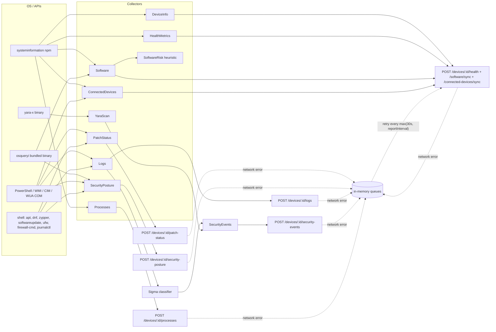

# 01 — Current State of the Novaris Endpoint Agent

**Scope:** `novaris-agent` only (agent version `1.0.4`, `package.json:3`). Backend (`novaris-backend`) and UI (`novaris-ui`) were **not** inspected by request, so persistence, rules, display and retention cannot be confirmed — everything below stops at the HTTP request the agent sends.
**Method:** static code review. No collector was executed against a real device.
**Confidence labels:** **C** = confirmed in code, **I** = inferred from code (behaviour depends on runtime/OS), **U** = unverified (needs a test).

---

## 1. Executive summary

- The agent already has a reasonable **core evidence set** on all three OSes: device identity, OS version, patch backlog, antivirus, host firewall, disk encryption, installed software. TPM and Secure Boot exist on Windows only.
- The main weakness is **evidence quality, not missing telemetry**. Many failure paths turn "could not check" into a definitive `false`/`0`. Some of those become a **false PASS** (patch status) and others a **false FAIL** (macOS antivirus, encryption when osquery is missing). Nothing in the payloads can express `UNKNOWN`/`ERROR`.
- Several identity facts are **collected once at registration and never refreshed**: OS version, IP and MAC. `currentUser` is collected but never sent.
- The agent collects a significant amount of **non-compliance, privacy-sensitive telemetry** by default:
  - the full process list with Windows command lines, every 60 s;
  - System/Application event-log messages, every 5 min;
  - Wi-Fi SSID/BSSID, USB and Bluetooth serials;
  - YARA scans of the user's Downloads and Desktop folders.
- Key compliance signals are **missing**: local admin membership, screen-lock policy, reboot pending (Windows), remote access exposure, audit policy, and agent/collector health.
- In the **headless service mode** (SYSTEM/root, the production path from `installers/`) a few collectors behave differently from the desktop mode. Examples: `currentUser` = SYSTEM/root, and YARA scans SYSTEM's own profile. The osquery binary may not be present, which silently empties the software inventory and encryption results (**U**, needs test).

---

## 2. End-to-end flow (agent side)

- Orchestration: `src/services/agentService.ts:99-145`. Network-gateway collectors (syslog, SNMP, active discovery, Zeek) run only when `agentMode === 'network_gateway'` (`agentService.ts:127-134`). They are **out of scope** for endpoint compliance and default off (`src/types/config.ts:116-125`).
- Transport: Axios, header `X-API-Key`, 30 s timeout (`src/services/reportingService.ts:27-34`). Retries use exponential backoff. Failed reports go to **in-memory** queues (`reportingService.ts:17-22`), which are lost on restart and unbounded in size (**C**).
- Runtime privilege:
  - Windows service: a scheduled task as `SYSTEM` (`installers/windows/install.ps1:92`).
  - Linux: a systemd unit, `User=root` (`installers/linux/debian/install.sh:78`).
  - macOS: a root LaunchDaemon (`installers/macos/install.sh:69-104`).
  - The Electron desktop app runs as the logged-in user and stays idle when the service is detected (`src-electron/main.ts:587-604`).

---

## 3. Inventory table

Legend for **Status**: `Impl` = collector code exists · `Sent` = included in the HTTP payload · `Rule` = evaluated by an agent-side rule. Backend persistence, display and rules are **not verifiable** here. Cadence defaults come from `src/types/config.ts:82-127`.

### 3.1 Device & identity — `DeviceInfoCollector` (`src/collectors/deviceInfoCollector.ts`)

| Field | Source | Evidence | Status | Cadence | OS | Notes / failure modes |
|---|---|---|---|---|---|---|
| hostname | `os.hostname()` | `deviceInfoCollector.ts:13` | Impl, Sent (registration only) | once | W/M/L | **C**: sent only in `/devices/register` (`reportingService.ts:208-217`). |
| serialNumber | `si.system().serial` | `:31-46` | Impl, Sent (registration + asset create) | once | W/M/L | Linux DMI serial often needs root (**I**). |
| currentUser | `os.userInfo().username` | `:49` | Impl, **never sent** | — | W/M/L | **C**: not in any payload. In service mode it returns `SYSTEM`/`root`, not the logged-on user (**I**). |
| osType / osVersion | `si.osInfo()` distro + release | `:17-28` | Impl, Sent (registration only) | once | W/M/L | **C**: the health payload (`reportingService.ts:266-274`) does not include OS version, and `lastDeviceInfo` is cached for the process lifetime (`agentService.ts:650-652`). **After an OS upgrade the backend never learns the new version.** No build number, edition or architecture. |
| ipAddress / macAddress | first non-internal IPv4 iface | `:52-89` | Impl, Sent (registration only) | once | W/M/L | Picks an arbitrary interface (it can be a VPN or virtual adapter). Never refreshed. |
| agentVersion | `package.json` | `:92-99` | Impl, Sent every health report | 5 min | all | **C** `reportingService.ts:273`. |

### 3.2 Operational health — `HealthMetricsCollector`

| Field | Source | Evidence | Status | Cadence | Notes |
|---|---|---|---|---|---|
| cpuUsage, cpuCores, ramUsage, diskUsage (first fs only), uptime, collectedAt | `si.currentLoad/mem/fsSize/time` + Windows PowerShell/typeperf fallback | `healthMetricsCollector.ts:12-38`, `:97-208` | Impl, Sent | 5 min | Ops telemetry, not compliance evidence. `uptime` is useful for "reboot overdue". `diskUsage` uses `fsSize[0]`, which may not be the system drive (**I**). The Windows fallback logs at `info` on every run (`:139-195`), which is noisy. |

### 3.3 Software inventory — `SoftwareCollector` + `SoftwareRiskCollector`

| Field | Source | Evidence | Status | Cadence | Notes |
|---|---|---|---|---|---|
| name, version, installedAt | 1st try `si.apps()`; fallback osquery `programs` (W), `apps` (M), `deb_packages`/`rpm_packages` (L) | `softwareCollector.ts:47-90`, `:105-169` | Impl, Sent via `/software/sync` | 1 h (`config.ts:89`) | **C**: `si.apps` **does not exist** in the installed `systeminformation@5.27.11` (no export in `node_modules/systeminformation/lib/index.js`), so the osquery path is the only real path. If osquery is missing, the result is `[]`. The sync is then **skipped silently** (`reportingService.ts:652-655`) and the backend keeps a stale list. There is no publisher/vendor field and no install scope, which weakens CVE correlation. Linux misses snap/flatpak/AppImage. On macOS only the `apps` table is used (no pkgutil receipts or Homebrew). |
| hackedIndicators / missingLicenseIndicators | Keyword match on name/version | `softwareRiskCollector.ts:16-51`, `:90-154` | Impl, Sent as counts + top-10 samples in posture metadata **and** as free text appended to patch `details` | 6 h | Heuristic, low precision ("loader", "patcher" and "project" all match legitimate software). **C**: the same result is duplicated into two payloads (`agentService.ts:695-697`, `:782-797`). |

### 3.4 Patch status — `PatchStatusCollector`

| Field | Source | Evidence | Status | Cadence | Notes |
|---|---|---|---|---|---|
| os, pendingUpdates, missingCritical, lastCheckedAt, details (free text ≤4000 chars) | **W**: WUA COM `IsInstalled=0 and IsHidden=0`, Security/Critical categories. **L**: `apt-get -s upgrade`, `dnf/yum check-update` + `updateinfo list security`, `zypper list-updates`. **M**: `softwareupdate -l`. | `patchStatusCollector.ts:82-159`, `:189-341`, `:343-402` | Impl, Sent to `/patch-status` and copied into posture | 6 h | **False PASS on failure:** every error path returns `pendingUpdates: 0, missingCritical: false` (`:70-79`, `:153-157`, `:222-228`, `:281-287`, `:394-400`). `lastCheckedAt` is the agent's collection time, not the last successful OS scan. `reboot_required` exists for Linux/macOS but only inside the `details` text. **Windows has no reboot-pending check.** `apt-get -s` does not refresh package lists, so results can be stale (**I**). macOS runs `softwareupdate -l` twice (`:351`, `:368`), which is slow and network-bound. No "last update installed" date and no OS end-of-support signal. |

### 3.5 Security posture — `SecurityPostureCollector`

| Field | W | M | L | Evidence | Notes / failure modes |
|---|---|---|---|---|---|
| antivirusInstalled / Enabled / UpToDate / ProductName | `Get-MpComputerStatus` + `root/SecurityCenter2 AntiVirusProduct` productState | **hard-coded `false`** | ClamAV only (`command -v clamscan`, `systemctl is-active clamav-daemon`) | `securityPostureCollector.ts:60-133`, `:196-199`, `:262-291` | **W false PASS:** if Defender is absent and *any* SecurityCenter product is registered, enabled and up-to-date are forced to `true` (`:126`, `:130`). **M false FAIL** always. **L:** `upToDate = enabled` with no signature check (`:290`), and EDRs other than ClamAV are not recognised. Defender "up to date" means signatures ≤ 7 days old, hard-coded (`:81`). |
| defender_realtime, defender_tamper, defender_signature_age_days | `Get-MpComputerStatus` | — | — | `:83-85`, `:152-154` | Sent only inside the untyped `metadata` blob. |
| firewallEnabled / firewallProfile | `Get-NetFirewallProfile -PolicyStore ActiveStore` | `socketfilterfw --getglobalstate`, fallback `defaults read com.apple.alf` | `ufw status` → `firewall-cmd --state` → `systemctl is-active firewalld` | `:72`, `:105-106`, `:235-253`, `:293-330` | **W false PASS:** enabled if **any** profile is on (`:106`), so a disabled Public profile still passes. **L:** `ufw status` needs root, so it fails in desktop mode and reports `false`. nftables/iptables-only hosts report `false`. |
| diskEncryptionEnabled / Method / Volumes | osquery `bitlocker_info` | osquery `disk_encryption` (FileVault) | osquery `disk_encryption` (LUKS) | `:170-187`, `:255-260`, `:332-347` | `enabled = any volume encrypted`, so the **system volume** is not specifically checked. If osquery is missing or not elevated, the result is `[]` and the device reports "not encrypted" (false FAIL). `isOsqueryAvailable()` exists (`src/utils/osquery.ts:60-62`) but **is never called** (**C**). Recovery keys are not collected (**C**, good). |
| tpm_present, tpm_ready, secure_boot_enabled | `Get-Tpm`, `Confirm-SecureBootUEFI` | — | — | `:74-77`, `:157-159` | Windows only, metadata only. Both need admin, so they return `null` in desktop mode (correct). |
| patch* fields, software*IndicatorsCount | copied from the other collectors | — | — | `agentService.ts:776-797` | Duplicates (see 03). |
| Global failure | — | — | — | `:54-57`, `:162-167` | Any exception returns `DEFAULT_POSTURE`, i.e. all `false`. That is indistinguishable from a real FAIL. |

### 3.6 Logs and security events — `LogCollector`, Sigma classifier

| Field | Source | Evidence | Status | Cadence | Notes |
|---|---|---|---|---|---|
| severity, source, message, raw (off by default), collectedAt | **W**: `Get-WinEvent` System + Application, ≥ warning, ≤200. **L**: `journalctl -o json`, fallback `tail /var/log/syslog`. **M**: **none** (`logCollector.ts:84`). | `logCollector.ts:87-139`, `:164-268` | Impl, Sent to `/logs` | 5 min | Full event message text is sent. Redaction covers only `Bearer`, `api_key=`, `password=` (`:47-52`). The Windows **Security** log is not read, so the Sigma rules for authentication failure, account lockout and privilege escalation rarely fire on Windows (**I**). |
| security events | Sigma substring rules (`src/rules/sigma/*.yml`) on log messages; YARA matches | `utils/securityEventClassifier.ts:36-57`, `agentService.ts:362-409` | Impl, Sent to `/security-events` | with logs / 24 h | Message-substring matching, not structured event IDs. |

### 3.7 Processes — `ProcessCollector`

| Field | Source | Evidence | Status | Cadence | Notes |
|---|---|---|---|---|---|
| processName, pid, cpuUsage, ramUsage, command (≤2000 chars) | `si.processes()` | `processCollector.ts:17-151`, `reportingService.ts:602-611` | Impl, Sent to `/processes` | **60 s** (`config.ts:103`) | **C**: on Windows `command` is the **full command line** (`node_modules/systeminformation/lib/processes.js:909`). Command lines can contain tokens, passwords, file paths and URLs. This is the largest and most sensitive stream, and it is not needed for any compliance control. |

### 3.8 Connected devices — `ConnectedDevicesCollector`

| Field | Source | Evidence | Status | Cadence | Notes |
|---|---|---|---|---|---|
| USB, Bluetooth, display, printer: identifier, name, vendor, model, serial | `si.usb/bluetoothDevices/graphics/printer` + Windows PowerShell PnP | `connectedDevicesCollector.ts:44-237`, `:811-890` | Impl, Sent via `/connected-devices/sync` | 5 min | Asset management. Serial numbers of peripherals and Bluetooth MACs of personal devices (phones, headsets). |
| router / Wi-Fi | `si.wifiConnections()` | `:239-284` | Impl, Sent | 5 min | **SSID and BSSID** (home Wi-Fi name, and a BSSID that can be geolocated). The ARP neighbour list is off by default (`config.ts:91`). |

### 3.9 YARA scan — `YaraScanCollector`

| Field | Source | Evidence | Status | Cadence | Notes |
|---|---|---|---|---|---|
| rule name, matched file path | yara-x over `~/Downloads`, `~/Desktop`, tmp (depth 1, ≤500 files, ≤25 MB) | `yaraScanCollector.ts:18-29`, `:37-110` | Impl, Sent as security events | 24 h | Only an EICAR rule ships (`src/rules/yara/eicar-test-file.yar`). In service mode `os.homedir()` is SYSTEM/root's home, so **users' folders are not scanned** (**I**). It duplicates the AV control. |

### 3.10 Response actions (not collection, but trust-relevant)

`src/services/responseActionService.ts:140-198`: an allowlisted set of actions (`collect_diagnostics`, `kill_process`, `enable_firewall`, `restart_device`, `scan_path`). `isolate_network` is blocked. The default mode is `acknowledge` (dry run, `config.ts:108`). It is authenticated only by the same shared API key. Commands are not signed.

---

## 4. Current grouping (agent side)

The agent groups evidence by **API endpoint**, not by security domain:

| Current group (endpoint) | Contents |
|---|---|
| `/devices/register`, `/assets/register` | identity (once) |
| `/devices/:id/health` | CPU/RAM/disk/uptime + agent version |
| `/software/sync` | software inventory |
| `/connected-devices/sync` | peripherals + Wi-Fi |
| `/patch-status` | patch + free-text details (+ software-risk text) |
| `/security-posture` | AV + firewall + encryption + copy of patch + software-risk counts + untyped `metadata` (Defender detail, TPM, Secure Boot, SecurityCenter raw objects) |
| `/logs`, `/security-events`, `/processes` | event/telemetry streams |

The critique is in [03-grouping-recommendations.md](03-grouping-recommendations.md).

---

## 5. Completeness gaps (summary)

| Gap | Kind | Confidence |
|---|---|---|
| No UNKNOWN/ERROR state; failures become `false`/`0` | Evidence integrity | C |
| OS version/IP/MAC never refreshed after registration | Stale evidence | C |
| No local admin / privileged group membership | Missing signal | C |
| No screen-lock / inactivity policy | Missing signal | C |
| No Windows reboot-pending; reboot only in Linux/mac free text | Missing / unstructured | C |
| No remote-access exposure (RDP, SSH, Screen Sharing) or listening-service summary | Missing signal | C |
| No audit-policy / logging configuration state | Missing signal | C |
| macOS antivirus (XProtect/Gatekeeper/3rd-party) not detected; macOS logs absent | Platform gap | C |
| Secure Boot / TPM only on Windows | Platform gap | C |
| No per-collector health, freshness or provenance (osquery present? elevated?) | Evidence health | C |
| Offline queue in memory, lost on restart | Evidence durability | C |
| osquery binary may be absent in service installs, silently breaking software + encryption | Deployment | U |
| No tests for any collector (`test/` covers only `agentRuntime` and `userSession`) | Quality | C |

## 6. What to test next (to turn U/I into C)

1. Install via `installers/windows/install.ps1` on a clean VM and check whether `resources/osquery/win32/osqueryi.exe` exists under `C:\Program Files\Novaris\Agent`. Capture one `/software/sync` and one `/security-posture` payload.
2. Run the desktop app as a non-admin Windows user and capture the posture payload. Expect `diskEncryptionEnabled:false` on a BitLocker device.
3. Stop the `wuauserv` service and capture `/patch-status`. Expect a false PASS (`missing_critical:false`).
4. On macOS, capture the posture payload. Expect `antivirus_enabled:false` despite XProtect.
5. On Windows, capture one `/processes` payload and check it for command-line arguments.
